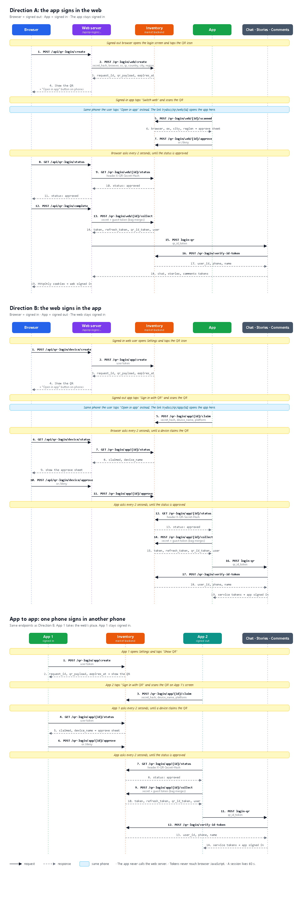

# QR login: flows and estimate

**Status:** proposal, nothing is built yet.

In Direction A and B, **the web shows the QR and the app scans it**. In app to app, the
signed-in app shows the QR. **The web never scans.**

- **Direction A:** the signed-in app signs in the web.
- **Direction B:** the signed-in web signs in the app.
- **App to app:** a signed-in app signs in another phone's app.
- **Same phone:** an "Open in app" button replaces the scan.

**Related files:**
- [qr-login-tasks.md](qr-login-tasks.md): the tasks for each developer, with every API
  request and response.
- [qr-login-flow.svg](qr-login-flow.svg) (also as [PNG](qr-login-flow.png)): the diagram
  of Direction A, Direction B and app to app, with every API call and the "Open in app"
  steps.

## 1. Direction A: sign in to the web from the app

1. The signed-out web shows a QR on the login screen.
2. In the signed-in app, the user taps "Switch web" and scans the QR.
3. The app shows the browser, system, city and region, with Approve and Deny.
4. The user taps Approve in the app.
5. The web server sees "approved" and collects new tokens and `qr_id_token` from
   inventory.
6. The web server signs in to chat, stories and comments with `qr_id_token`. Each service
   checks the token with inventory.
7. The web server sets the tokens as HttpOnly cookies. The web is now signed in.

The guest bag on the web merges into the account. The app stays signed in.

## 2. Direction B: sign in to the app from the web

1. The signed-in web user opens Settings and taps the QR icon. The web shows a QR.
2. The signed-out app taps "Sign in with QR", scans the QR and claims it.
3. The web shows the device name, with Approve and Deny.
4. The user taps Approve on the web.
5. The app sees "approved" and collects new tokens and `qr_id_token` directly from
   inventory.
6. The app signs in to chat, stories and comments with `qr_id_token`. Each service checks
   the token with inventory. The app is now signed in.

The guest bag on the app merges into the account. The web stays signed in.

**The app never calls the web server.** In every case, the app talks only to inventory
and to chat, stories and comments.

## 3. App to app: sign in a phone from another phone

This case is Direction B, with the signed-in app in the web's place. It uses the same
endpoints, so inventory builds nothing new.

1. The signed-in app opens Settings and taps "Show QR". The app shows a QR.
2. The signed-out app on the other phone taps "Sign in with QR", scans the QR and claims
   it.
3. The signed-in app shows the device name, with Approve and Deny.
4. The user taps Approve on the signed-in app.
5. The other app sees "approved", collects new tokens and `qr_id_token`, and signs in to
   chat, stories and comments.

The first phone stays signed in.

## 4. Same phone: "Open in app"

A phone's camera can't scan its own screen. So when the web and the app are on the same
phone, the QR alone does not work.

- **The fix:** on phones, the web shows an **"Open in app"** button under every QR. The
  button opens the same link that the QR holds (`trydos://qr/web/…` or
  `trydos://qr/app/…`).
- **What happens next:** the app opens the screen that it opens after a scan. From there,
  the flow is the same as Direction A or B.
- **No new API.** The link carries the same `request_id`.
- **If the app is not installed,** the link opens nothing. The QR stays on screen, so the
  user can still use another phone.
- **Risk:** a link is easier to send to someone than a QR. An attacker could send a victim
  a link to the attacker's own session. So the approve sheet must always show the browser
  and city, and must never approve by itself.

| Case | Shows the QR | Opens it | How |
|---|---|---|---|
| Computer web + phone app | Web | App | Scan |
| Phone web + app on the same phone | Web | App | "Open in app" |
| Phone app + another phone's app | Signed-in app | Signed-out app | Scan |

## 5. How the waiting side learns the result

In both directions, one side must wait for the other. There are two ways to do this.

### Flow 1: polling

The waiting side asks for the status every 2 seconds.

- **Delay:** up to 2 seconds.
- **Works on:** every browser, with no permission.
- **Direction A calls:** 30 for each QR, and 90 at most because the QR stops after 3 codes.

### Flow 2: FCM notification

Inventory sends a push when the status changes. The waiting side then asks for the status.

- **The push is only a signal.** It holds the `request_id`, with no tokens and no status.
- **Polling stays as a backup,** every 10 seconds, because a push can be late or lost.
- **The web needs notification permission to get an FCM token.** Without it, the web
  polls every 2 seconds, exactly as in Flow 1.
- **Do not ask for the permission on the login screen.** It adds a step that sign-in
  doesn't need.

### Comparison

| | Flow 1: polling | Flow 2: FCM |
|---|---|---|
| Delay when FCM is available | Up to 2 s | Usually shorter, not guaranteed |
| Delay when FCM isn't available | Up to 2 s | Up to 2 s |
| Delay if a push is lost | Not relevant | Up to 10 s |
| Calls for each QR | 30 | 6 with FCM, 30 without |
| Paths to test | 1 | 2 |
| Automatic testing | Full | Real push must be tested by hand |
| Extra work | None | About 3 person-days |

## 6. Rules for every case

**Session**

- A session lasts 60 seconds, and inventory enforces the limit.
- The QR holds only `trydos://qr/web/<request_id>` (A) or `trydos://qr/app/<request_id>`
  (B and app to app), never a token. The "Open in app" button uses the same link.
- The first scan or claim wins. A second device gets an error.
- Approved, denied and expired are final.
- The QR stops after 3 codes, and the user then taps "Show a new code".

**Tokens**

- Each device gets its own new tokens. Refresh tokens are single-use, so two devices
  can't share a pair.
- The waiting side proves itself with a secret. It sends the hash first and the secret
  only once, at collect.
- Inventory creates the tokens at collect, not at approve.
- Collect returns the same data as `verify_otp_from_guest`: `token`, `refresh_token` and
  the full `user`, with `qr_id_token` in place of `id_token`.
- Collect must return `refresh_token`. Access tokens live 60 seconds, so without it the
  session ends after about 1 minute.
- Tokens never reach browser JavaScript.

**`qr_id_token`**

- The OTP backend issues `id_token`, and chat, stories and comments verify it against the
  OTP backend. A QR login has no OTP step, so inventory issues its own `qr_id_token`.
- `qr_id_token` lives 60 seconds.
- Chat, stories and comments verify it with inventory's
  `POST /qr-login/verify-id-token`.

**Accounts**

- Only verified users can approve. Guests also have a token, so inventory must refuse them.
- Inventory takes the account from the token, never from the request body.
- Collect takes the guest token, so the guest bag can merge.

**Location**

- Cloudflare sits in front of the web. So the web server reads the user's IP, country,
  city and region from the `cf-*` headers and sends them to inventory.
- Inventory saves these values and does no lookup of its own.

## 7. What each developer builds

The full API, with each request and response, is in [qr-login-tasks.md](qr-login-tasks.md).

**Inventory**

- Session storage.
- Direction A endpoints: create, status, scanned, approve, deny, collect.
- Direction B endpoints: create for a signed-in user, claim, status, approve, deny, collect.
  App to app uses the same endpoints, so they accept a user token from the web server or
  the app.
- Token creation and guest bag merge.
- `qr_id_token` creation, and `POST /qr-login/verify-id-token` for chat, stories and
  comments.
- Flow 2 only: send the pushes.

**Web**

- Replace the fake QR service with real routes under `/api/qr-login`.
- Add a secret in an HttpOnly cookie to prove which browser made the QR.
- Read the location from the Cloudflare headers.
- Share the login steps between OTP login and QR login. QR login uses the new QR
  endpoints of chat, stories and comments.
- Change the Settings QR icon so it opens a QR, and show it on computers too.
- On phones, show an "Open in app" button under both QRs.
- Reuse the existing QR and approve components, and remove the web camera scanner.
- Add text in `ar`, `tr` and `ku`, then add tests.
- Flow 2 only: send the FCM token and handle the push.

**App**

- Build the same screens the web has today.
- Direction A: "Switch web" button, camera, approve screen.
- Direction B: "Sign in with QR" on the login screen, claim, wait, collect, sign in to the
  services through their new QR endpoints.
- App to app: "Show QR" in Settings, wait for a claim, approve screen with the device
  name.
- "Open in app": register the `trydos://` link scheme and open the right screen.
- Flow 2 only: handle the push.

**Chat, stories and comments**

- Add a QR login endpoint that takes `qr_id_token` and checks it with the inventory verify
  API. The OTP login endpoint does not change.
- Check that a new login doesn't end the session on the other device.

**QA**

- Test two devices, deny, expiry, guest bag and 3 languages.
- Test app to app on two phones, and "Open in app" on one phone.
- Flow 2 only: test each permission state and hidden tabs.

## 8. Estimate

This estimate assumes that **every developer uses a Claude agent**. That includes the
chat, stories and comments developers, and QA. The agent writes the code, the tests and
the translations, and reads the logs to find bugs.
These numbers are judgment, not measurement, because we have no timing from a similar
feature. Confirm them after the first few days of work.

**Assumptions**

- One developer for each role, with no other work.
- Every developer uses a Claude agent, working on one task at a time.
- A developer reads and approves every change before it merges.
- Inventory issues its own `qr_id_token`, because the OTP backend issues `id_token` and a
  QR login has no OTP step.
- The wallet is left out.
- Every column includes "Open in app". The A + B columns also include app to app, because
  app to app reuses Direction B.
- The agent has access to each repo. The app numbers are the least certain, because we
  didn't read that code.

### Person-days

| Who | Polling, A only | Polling, A + B | FCM, A + B |
|---|---|---|---|
| Inventory | 2–3 | 2.5–4 | 3–4.5 |
| Web | 2–3 | 2.5–4 | 3.5–5 |
| App | 1.5–3 | 3.5–6 | 4–6.5 |
| Chat | 1–1.5 | 1–1.5 | 1–1.5 |
| Stories | 1–1.5 | 1–1.5 | 1–1.5 |
| Comments | 1–1.5 | 1–1.5 | 1–1.5 |
| QA | 1.5–2.5 | 2–3.5 | 3–4.5 |
| **Total** | **10–16** | **13.5–22** | **16.5–25** |

### Working days

All developers work at the same time, so the build phase is as long as the busiest
developer's work. In the A + B columns, the app developer is the busiest. Inventory
builds the verify API first, because chat, stories and comments need it to test.

| Phase | Polling, A only | Polling, A + B | FCM, A + B |
|---|---|---|---|
| Agree the API | 0.5–1.5 | 0.5–1.5 | 0.5–1.5 |
| Build | 2–3 | 3.5–6 | 4–6.5 |
| Test together and fix | 1.5–2 | 2.5–3.5 | 3–4 |
| **Total** | **4–6.5** | **6.5–11** | **7.5–12** |
| **In weeks** | 1–1.5 | 1.5–2.5 | 1.5–2.5 |

App store review is extra. Both directions need app screens, so ship them in one release.

## 9. Recommendation

**Build polling for both directions.**

- FCM still needs polling, so it adds work and replaces nothing.
- FCM saves at most about 2 seconds, and only where it is available.
- FCM can be added later if real data shows that polling is a problem.
