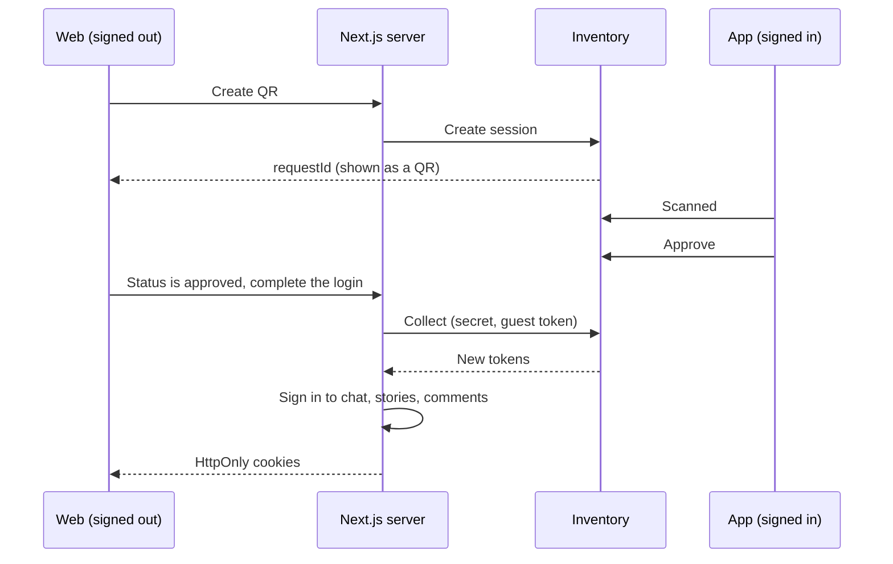
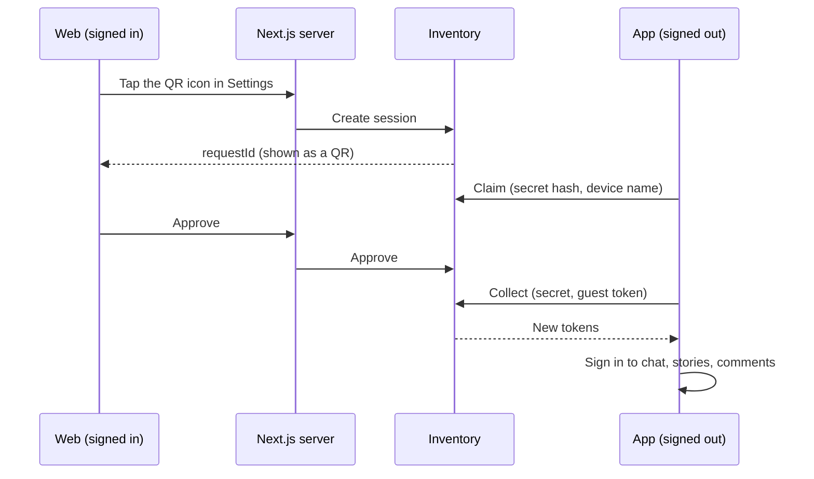

# QR login: flows and estimate

**Status:** proposal, nothing is built yet.

In both directions, **the web shows the QR and the app scans it**.

- **Direction A:** the signed-in app signs in the web.
- **Direction B:** the signed-in web signs in the app.

## 1. Direction A: sign in to the web from the app

1. The signed-out web shows a QR on the login screen.
2. In the signed-in app, the user taps "Switch web" and scans the QR.
3. The app shows the browser, system and city, with Approve and Deny.
4. The user taps Approve in the app.
5. The Next.js server collects new tokens from inventory.
6. The Next.js server signs in to chat, stories and comments with `id_token`.
7. The Next.js server sets the tokens as HttpOnly cookies. The web is now signed in.

The guest bag on the web merges into the account. The app stays signed in.

## 2. Direction B: sign in to the app from the web

1. The signed-in web user opens Settings and taps the QR icon. The web shows a QR.
2. The signed-out app scans the QR.
3. The web shows the device name, with Approve and Deny.
4. The user taps Approve on the web.
5. The app collects new tokens directly from inventory.
6. The app signs in to chat, stories and comments with `id_token`. The app is now signed in.

The web stays signed in.

## 3. How the waiting side learns the result

In both directions, one side must wait for the other. There are two ways to do this.

### Flow 1: polling

The waiting side asks for the status every 2 seconds.

- **Delay:** up to 2 seconds.
- **Works on:** every browser, with no permission.
- **Direction A calls:** 30 for each QR, and 90 at most because the QR stops after 3 codes.

### Flow 2: FCM notification

Inventory sends a push when the status changes. The waiting side then asks for the status.

- **The push is only a signal.** It holds the `requestId`, with no tokens and no status.
- **Polling stays as a backup,** every 10 seconds, because a push can be late or lost.
- **The web needs notification permission to get an FCM token.** Without it, the web
  polls every 2 seconds, exactly as in Flow 1.
- **Do not ask for the permission on the login screen.** It adds a step that sign-in
  doesn't need.

### Comparison

| | Flow 1: polling | Flow 2: FCM |
|---|---|---|
| Delay when FCM is available | Up to 2 s | Usually shorter, not guaranteed |
| Delay when FCM isn't available | Up to 2 s | Up to 2 s |
| Delay if a push is lost | Not relevant | Up to 10 s |
| Calls for each QR | 30 | 6 with FCM, 30 without |
| Paths to test | 1 | 2 |
| Automatic testing | Full | Real push must be tested by hand |
| Extra work | None | 3–4.5 person-days |

## 4. Rules for both directions

**Session**

- A session lasts 60 seconds, and inventory enforces the limit.
- The QR holds only a random `requestId`, never a token.
- The first scan wins. A second device gets an error.
- Approved, denied and expired are final.
- The QR stops after 3 codes, and the user then taps "Show a new code".

**Tokens**

- Each device gets its own new tokens. Refresh tokens are single-use, so two devices
  can't share a pair.
- Inventory returns the tokens only to the side that proves the secret, and only once.
- Inventory creates the tokens at collect, not at approve.
- Collect must return `refresh_token`. Access tokens live 60 seconds, so without it the
  session ends after about 1 minute.
- Tokens never reach browser JavaScript.

**Accounts**

- Only verified users can approve. Guests also have a token, so inventory must refuse them.
- Inventory takes the account from the token, never from the request body.
- Collect takes the guest token, so the guest bag can merge.
- A QR login doesn't sign in to the wallet, because a scan shouldn't reach money.
- Each sign-in sends a "new sign-in" push to the user's other devices.

## 5. What each developer builds

**Inventory**

- Session storage and rate limits.
- Direction A endpoints: create, status, scanned, approve, deny, collect.
- Direction B endpoints: create for a signed-in user, claim, status, approve, deny, collect.
- Token creation and guest bag merge.
- Flow 2 only: send the pushes.

**Web**

- Replace the fake QR service with real Next.js routes.
- Add a secret in an HttpOnly cookie to prove which browser made the QR.
- Share the login steps between OTP login and QR login.
- Change the Settings QR icon so it opens a QR, and show it on computers too.
- Reuse the existing QR and approve components, and remove the web camera scanner.
- Add text in `ar`, `tr` and `ku`, then add tests.
- Flow 2 only: send the FCM token and handle the push.

**Flutter**

- Direction A: "Switch web" button, camera, approve screen.
- Direction B: scan from the login screen, claim, wait, collect, sign in to the services.
- Flow 2 only: handle the push.

**Chat, stories and comments**

- Check that `id_token` from a QR login works.
- Check that a new login doesn't end the session on the other device.
- Change code only if a check fails.

**QA**

- Test two devices, deny, expiry, guest bag and 3 languages.
- Flow 2 only: test each permission state and hidden tabs.

## 6. Estimate

This estimate assumes that **each developer uses a Claude agent to write the code**.
These numbers are judgment, not measurement, because we have no timing from a similar
feature. Confirm them after the first few days of work.

**Assumptions**

- One developer for each role, with no other work.
- One Claude agent for each developer, working on one task at a time.
- A developer reads and approves every change before it merges.
- Inventory can issue `id_token` without an OTP.
- The wallet is left out.
- The agent has access to each repo. The Flutter numbers are the least certain, because
  we didn't read that code.

**What the agent speeds up:** writing endpoints, routes and screens, moving the login
steps into shared code, writing tests, adding translations, and finding bugs in logs.

**What the agent doesn't speed up much:**

- Waiting for other developers to answer questions.
- A person reviewing the token and security code.
- Deploying to staging.
- Testing the camera and two real devices on iOS and Android.
- App store review.

### Person-days

| Who | Polling, A only | Polling, A + B | FCM, A + B |
|---|---|---|---|
| Inventory | 2–4 | 3–5 | 3.5–6 |
| Web | 2–3.5 | 3–5 | 4–6.5 |
| Flutter | 1.5–3 | 3–5 | 3.5–5.5 |
| Chat | 0.5–1.5 | 0.5–1.5 | 0.5–1.5 |
| Stories | 0.5–1.5 | 0.5–1.5 | 0.5–1.5 |
| Comments | 0.5–1.5 | 0.5–1.5 | 0.5–1.5 |
| QA | 1.5–2.5 | 2–3.5 | 3–5 |
| **Total** | **8.5–17.5** | **12.5–23** | **15.5–27.5** |

### Working days

Inventory, web and Flutter work at the same time, so the build phase is as long as the
busiest developer's work.

| Phase | Polling, A only | Polling, A + B | FCM, A + B |
|---|---|---|---|
| Agree the API, check `id_token` | 1–2 | 1–2 | 1–2 |
| Build | 2–4 | 3–5 | 4–7 |
| Test together and fix | 2–3 | 3–4 | 4–5 |
| **Total** | **5–9** | **7–11** | **9–14** |
| **In weeks** | 1–2 | 1.5–2.5 | 2–3 |

App store review is extra. Both directions need app screens, so ship them in one release.

## 7. Recommendation

**Build polling for both directions.**

- FCM still needs polling, so it adds work and replaces nothing.
- FCM saves at most about 2 seconds, and only where it is available.
- FCM can be added later if real data shows that polling is a problem.

## 8. Questions to answer first

| # | Question | Who answers | Why it matters |
|---|---|---|---|
| 1 | Can inventory issue `id_token` without an OTP? | Inventory | **Biggest risk.** If not, chat, stories and comments must change, which could add about 3–5 working days. |
| 2 | Do chat, stories and comments accept that `id_token`? | Their developers | Otherwise those services won't sign in. |
| 3 | Does a new login end the session on the other device? | Chat, stories, comments developers | The user could be signed out of those services on one device. |
| 4 | Who is the Flutter developer? | Product | The app side can't be built without one. |
| 5 | Who owns the comments service? | Product | Someone must answer questions 2 and 3 for it. |
| 6 | Is the wallet left out of QR login? | Product | This plan assumes yes. |
| 7 | What should the Settings QR icon open? | Product | The XD design opens a Client ID screen from it. This plan opens a login QR. |

## 9. Main risks

- **Scam in Direction A:** an attacker can trick someone into approving the attacker's
  QR. The approve screen shows the browser and city to help the user notice.
- **Stolen web session in Direction B:** someone with access to the signed-in web could
  sign in an app. The Approve step alone doesn't stop them, so the "new sign-in" push
  warns the real user.
- **One phone only:** a phone can't scan its own screen, so the user needs a second device.
