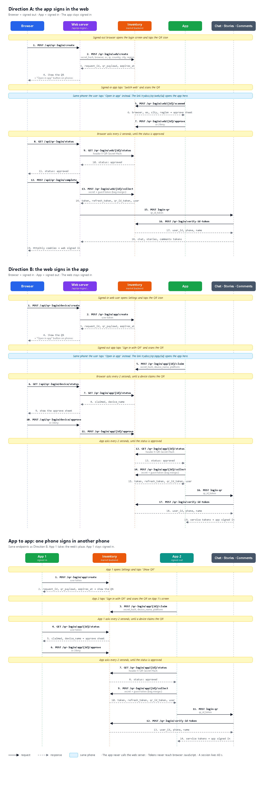

# QR login: tasks for each developer

**Status:** proposal, nothing is built yet.

This file splits [qr-login-flows.md](qr-login-flows.md) into tasks for each developer. It
follows the recommendation in that file: **polling, both directions (A + B)**.

- **Direction A:** the signed-in app signs in the web.
- **Direction B:** the signed-in web signs in the app.
- **App to app:** a signed-in app signs in another phone's app. It is Direction B, with
  the signed-in app in the web's place. It needs no new API.
- **Same phone:** the QR can't be scanned on the phone that shows it. So under every QR,
  phones also show an **"Open in app"** button. The button opens the same link that the
  QR holds. It needs no new API.



The same diagram as a vector file: [qr-login-flow.svg](qr-login-flow.svg).

In Direction A and B, the web shows the QR and the app scans it. In app to app, the
signed-in app shows the QR and the other app scans it. The web never scans. The waiting
side asks for the status every 2 seconds.

The paths are a proposal. The market backend developer can rename them, but every
developer must agree on the final names on day 1.

## Shared rules

- **Session life:** 60 seconds. The backend enforces it.
- **QR content:** `trydos://qr/web/<request_id>` (A) or `trydos://qr/app/<request_id>`
  (B and app to app). The QR holds only the ID, never a token.
- **"Open in app" link:** the same `qr_payload` as the QR. The app opens the same screen
  that it opens after a scan.
- **Statuses:** `pending`, `scanned` (A) or `claimed` (B), `approved`, `denied`, `expired`.
  `approved`, `denied` and `expired` are final.
- **Secret:** the waiting side makes 32 random bytes (`secret`) and its SHA-256 hex
  (`secret_hash`).
  - It sends `secret_hash` first.
  - It sends `secret` only once, at collect.
  - The secret proves that the device that collects is the device that started.
- **Collect answer:** the same `data` as `verify_otp_from_guest`, with `token`,
  `refresh_token` and the **full `user` object**. It holds `qr_id_token` in place of
  `id_token`.
- **Why `qr_id_token`:** the OTP backend issues `id_token`, and chat, stories and comments
  verify it against the OTP backend. A QR login has no OTP step, so the inventory issues
  its own `qr_id_token` instead.
  - The inventory offers a verify API for it (`POST /qr-login/verify-id-token`).
  - Chat, stories and comments each add a QR login endpoint that calls this verify API.
  - The existing OTP login endpoints do not change.
- **Response format:** the market API's usual format.

  Success:

  ```json
  { "isSuccessful": true, "message": "ok", "data": { } }
  ```

  Error:

  ```json
  { "isSuccessful": false, "message": "The session expired." }
  ```

  The client chooses what to show from the HTTP code. It never shows `message`.
- **Errors:**

| Code | When |
|---|---|
| 400 | A field is missing or wrong |
| 401 | The token is missing or expired |
| 403 | A guest tries to approve, the secret is wrong, or the user doesn't own the session |
| 404 | No session has this ID |
| 409 | Someone else already scanned or claimed the QR, or the tokens were already collected |
| 410 | The session expired |
| 429 | Too many requests |

---

## 1. Market backend developer

*Estimate: 2.5–4 days.*

### Direction A: the app signs in the web

#### `POST /qr-login/web/create`

- **Caller:** the web server, with the browser's guest token.
- **Rule:** read every value from the body. Don't read them from your own headers, because
  those headers describe the web server. Any location field can be `null`.

Request:

```json
{
  "secret_hash": "9f2c…64 hex characters",
  "browser": "Chrome",
  "os": "Windows",
  "ip": "65.0.21.24",
  "country": "IN",
  "city": "Mumbai",
  "region": "Maharashtra"
}
```

Response `201`:

```json
{
  "isSuccessful": true,
  "message": "ok",
  "data": {
    "request_id": "3f1c2a7e-8b4d-4c1a-9e2f-6a7b8c9d0e1f",
    "qr_payload": "trydos://qr/web/3f1c2a7e-8b4d-4c1a-9e2f-6a7b8c9d0e1f",
    "expires_at": "2026-11-14T10:01:00Z"
  }
}
```

#### `GET /qr-login/web/{request_id}/status`

- **Caller:** the web server, every 2 seconds.
- **Header:** `X-QR-Secret-Hash: 9f2c…`
- **Request:** no body.

Response `200`:

```json
{ "isSuccessful": true, "message": "ok", "data": { "status": "approved" } }
```

#### `POST /qr-login/web/{request_id}/scanned`

- **Caller:** the app, with a user token.
- **Request:** no body.
- **Rules:**
  - A guest gets 403.
  - The first user who scans owns the session. Another user gets 409.

Response `200`:

```json
{
  "isSuccessful": true,
  "message": "ok",
  "data": {
    "browser": "Chrome",
    "os": "Windows",
    "city": "Mumbai",
    "region": "Maharashtra",
    "country": "IN",
    "expires_at": "2026-11-14T10:01:00Z"
  }
}
```

#### `POST /qr-login/web/{request_id}/approve` and `/deny`

- **Caller:** the app, with the token of the user who scanned.
- **Request:** no body.
- **Rules:**
  - Take the account from the token, never from the body.
  - Create no tokens here.

Response `200`:

```json
{ "isSuccessful": true, "message": "ok", "data": { "status": "approved" } }
```

`/deny` returns `"status": "denied"`.

#### `POST /qr-login/web/{request_id}/collect`

- **Caller:** the web server, with the browser's guest token.
- **Rules:**
  - The status must be `approved`, and the hash of `secret` must match.
  - The endpoint works only once. A second call gets 409.
  - Create a new token pair for this browser only.
  - Merge the guest bag into the account.

Request:

```json
{ "secret": "q1W…43 characters" }
```

Response `200`: the same `data` as `verify_otp_from_guest`.

```json
{
  "isSuccessful": true,
  "message": "ok",
  "data": {
    "token": "<access token>",
    "refresh_token": "<refresh token>",
    "qr_id_token": "<qr id token>",
    "user": {
      "id": 1234,
      "name": "Alaa",
      "phone": "+963900000000",
      "email": null,
      "image": "https://…",
      "is_phone_verified": 1
    }
  }
}
```

`user` is the **full** user object, with every field that `verify_otp_from_guest`
returns. The fields above are only an example.

`qr_id_token` rules:
- The inventory issues it at collect, for this user only.
- It lives 60 seconds. That is enough time for the 3 service logins that follow.
- It is not `id_token`, and the OTP backend does not know it. Only
  `POST /qr-login/verify-id-token` can verify it.

### Direction B and app to app: sign in a phone's app

The same endpoints serve both cases. In Direction B, the web server calls them. In app to
app, the signed-in app calls them. Accept a user token from either caller, and do not
check which one sent it.

#### `POST /qr-login/app/create`

- **Caller:** the web server or a signed-in app, with a user token. A guest gets 403.
- **Request:** no body.

Response `201`:

```json
{
  "isSuccessful": true,
  "message": "ok",
  "data": {
    "request_id": "7a9e4c21-0b3d-4f6e-8a1c-2d3e4f5a6b7c",
    "qr_payload": "trydos://qr/app/7a9e4c21-0b3d-4f6e-8a1c-2d3e4f5a6b7c",
    "expires_at": "2026-11-14T10:01:00Z"
  }
}
```

#### `POST /qr-login/app/{request_id}/claim`

- **Caller:** the app, with its guest token.
- **Rule:** the first claim wins. A second device gets 409.

Request:

```json
{
  "secret_hash": "4b1d…64 hex characters",
  "device_name": "Alaa's iPhone",
  "platform": "ios"
}
```

Response `200`:

```json
{
  "isSuccessful": true,
  "message": "ok",
  "data": { "status": "claimed", "expires_at": "2026-11-14T10:01:00Z" }
}
```

#### `GET /qr-login/app/{request_id}/status`

- **Callers:**
  - **The side that showed the QR** (the web server, or the signed-in app) sends a user
    token.
  - **The app that claimed** sends the header `X-QR-Secret-Hash: 4b1d…`.
- **Request:** no body.

Response `200` to the side that showed the QR:

```json
{
  "isSuccessful": true,
  "message": "ok",
  "data": { "status": "claimed", "device_name": "Alaa's iPhone", "platform": "ios" }
}
```

Response `200` to the app that claimed:

```json
{ "isSuccessful": true, "message": "ok", "data": { "status": "approved" } }
```

#### `POST /qr-login/app/{request_id}/approve` and `/deny`

- **Caller:** the web server or the signed-in app, with the token of the user who created
  the session.
- **Request:** no body.
- **Rule:** create no tokens here.

Response `200`:

```json
{ "isSuccessful": true, "message": "ok", "data": { "status": "approved" } }
```

`/deny` returns `"status": "denied"`.

#### `POST /qr-login/app/{request_id}/collect`

- **Caller:** the app, with its guest token.
- **Rules:** the same as `web/collect`.

Request:

```json
{ "secret": "Zp8…43 characters" }
```

Response `200`: the same as `web/collect`. That means `token`, `refresh_token`,
`qr_id_token` and the full `user`.

### For chat, stories and comments

#### `POST /qr-login/verify-id-token`

Chat, stories and comments call this API to check a `qr_id_token`. It works like the OTP
backend's verify, which they call today for `id_token`.

- **Caller:** the chat, stories and comments servers. Never a browser or the app.
- **Auth:** protect it the same way the OTP backend protects its verify API.
- **Rules:**
  - The token must be one that the inventory issued, for a verified user, less than
    60 seconds ago.
  - The answer gives the user from the token, never from the request.

Request:

```json
{ "qr_id_token": "<qr id token>" }
```

Response `200`:

```json
{
  "isSuccessful": true,
  "message": "ok",
  "data": {
    "user_id": 1234,
    "phone": "+963900000000",
    "name": "Alaa"
  }
}
```

Response `401`: the token is wrong or expired.

```json
{ "isSuccessful": false, "message": "Invalid or expired qr_id_token." }
```

---

## 2. Stories, chat and comments developers

*Estimate: 1–1.5 days each.*

Each service adds **one new login endpoint** for QR login. The existing OTP login endpoint
does not change.

The new endpoint works like the OTP one, with one difference: it verifies a `qr_id_token`
with the inventory, not an `id_token` with the OTP backend.

The work is the same for each service:

1. Take `qr_id_token` from the body.
2. Call the inventory `POST /qr-login/verify-id-token` (section 1).
3. On `401` from the inventory, return `401`.
4. On `200`, take `user_id`, `phone` and `name` from the inventory answer, **never from
   the body**.
5. Find or create the user, and return a token pair, as the OTP login does today.

The paths below are a proposal. Each service developer can rename them.

#### Chat: `POST /api/v1/users/login-qr`

Request:

```json
{ "qr_id_token": "<qr_id_token from collect>" }
```

Response `200`: the same as `POST /api/v1/users/login` today.

#### Stories: `POST /api/v1/users/login-qr`

Request:

```json
{ "qr_id_token": "<qr_id_token from collect>" }
```

Response `200`: the same as `POST /api/v1/users/login` today.

#### Comments: `POST /public_comment/auth/exchange_qr_token`

Request:

```json
{ "qr_id_token": "<qr_id_token from collect>" }
```

Response `200`: the same as `POST /public_comment/auth/exchange_token` today.

Run these checks:
1. Sign in with a `qr_id_token` from a QR login. The endpoint must return a token pair.
2. Send a wrong or expired `qr_id_token`. The endpoint must return `401`.
3. Sign in to the same account from a second device. The first device must stay signed
   in, and its refresh must still work.

---

## 3. Web developer

*Estimate: 2.5–4 days.*

**Status:** built on 2026-11-14. It waits for the market backend (section 1) and for the
QR endpoints of chat, stories and comments (section 2). When those are live, test the
whole flow on staging.

- Routes: `app/api/qr-login/**`. Shared server code: `utils/server/qrLogin.ts`.
- OTP login and QR login share their sign-in steps in `utils/server/finishLogin.ts`.
- Browser calls: `services/qrLogin/index.ts`.
- Screens: `components/Login/Enhanced/screens/QrLoginScreen.tsx` (login) and
  `components/Login/QrDeviceSheet.tsx` (Settings).
- **Short tokens:** the market access token lives 60 seconds. The routes never refresh
  the pair, because the refresh token is single-use. A 401 goes back to the browser,
  which runs the app's shared refresh once and sends the call again.
- The service paths (`login-qr`, `exchange_qr_token`) are in `utils/fetch/Endpoints.ts`.
  Change them there if a service picks another path.
- QR login does not sign in to the wallet.
- **Hidden for now:** the QR buttons (login first screen, Settings profile card) show only
  when `NEXT_PUBLIC_QR_LOGIN_ENABLED` is `"true"` (`isQrLoginEnabled` in
  `services/qrLogin`). Turn it on when the backends in sections 1 and 2 are live.

The browser calls only these routes, never the market backend. Tokens and the secret
never reach browser JavaScript.

**Error format for every route:**

```json
{ "error": "expired" }
```

The route uses the same HTTP code that the market backend returned.

### Direction A: the signed-out web

#### `POST /api/qr-login/create`

The route does these steps:

1. It makes `secret` and saves it in an HttpOnly cookie (`QR-LOGIN-SECRET`, 90 seconds).
2. It reads the location from the request headers. See the table below.
3. It calls `web/create`.

- **Request:** no body.

Response `200`:

```json
{
  "requestId": "3f1c2a7e-8b4d-4c1a-9e2f-6a7b8c9d0e1f",
  "qrPayload": "trydos://qr/web/3f1c2a7e-8b4d-4c1a-9e2f-6a7b8c9d0e1f",
  "expiresAt": 1794643260000
}
```

`expiresAt` is in epoch milliseconds, as `services/qrLogin/index.ts` expects.

#### `GET /api/qr-login/status?id=3f1c…`

- The route calls `web/status` with the hash of the cookie secret.

Response `200`:

```json
{ "status": "approved" }
```

#### `POST /api/qr-login/complete`

The browser calls this route when the status is `approved`. The route does these steps:

1. It calls `web/collect` with the cookie secret and the guest token. An answer
   without `token`, `refresh_token`, `user` or `qr_id_token` gets a `502`.
2. It runs the same steps as OTP login in `/api/auth/login`, with one difference:
   1. It signs in to chat, stories and comments through their **new QR endpoints**
      (section 2), with `qr_id_token`.
   2. It sets the cookies.
3. It deletes the secret cookie.

Request:

```json
{ "requestId": "3f1c2a7e-8b4d-4c1a-9e2f-6a7b8c9d0e1f" }
```

Response `200`: the same answer as `/api/auth/login`, with the full `user`. The answer
holds no token.

#### Where the location comes from

Cloudflare sits in front of Vercel, so the `x-vercel-ip-*` headers describe a Cloudflare
server. Never use them. Use these Cloudflare headers instead. A live test on 2026-11-14
confirmed that they arrive.

| Field | Header |
|---|---|
| `ip` | `cf-connecting-ip` |
| `country` | `cf-ipcountry` (send `null` for `XX` and `T1`) |
| `city` | `cf-ipcity` |
| `region` | `cf-region` |
| `browser`, `os` | read from `user-agent` |

### Direction B: the signed-in web

#### `POST /api/qr-login/device/create`

- The route calls `app/create`.
- **Request:** no body.

Response `200`:

```json
{
  "requestId": "7a9e4c21-0b3d-4f6e-8a1c-2d3e4f5a6b7c",
  "qrPayload": "trydos://qr/app/7a9e4c21-0b3d-4f6e-8a1c-2d3e4f5a6b7c",
  "expiresAt": 1794643260000
}
```

#### `GET /api/qr-login/device/status?id=7a9e…`

- The route calls `app/status`.

Response `200`:

```json
{ "status": "claimed", "deviceName": "Alaa's iPhone", "platform": "ios" }
```

#### `POST /api/qr-login/device/approve` and `/deny`

- The route calls `app/approve` or `app/deny`.

Request:

```json
{ "requestId": "7a9e4c21-0b3d-4f6e-8a1c-2d3e4f5a6b7c" }
```

Response `200`:

```json
{ "status": "approved" }
```

`/deny` returns `{ "status": "denied" }`.

### Screens and other work

- **Login screen:** show the real QR. Make a new code when one expires. After 3 codes,
  show "Show a new code".
- **Settings:** the QR icon opens the QR, on computers too. After a claim, show the
  approve sheet with the device name.
- **"Open in app" button:** on phones only, show the button under both QRs (login screen
  and Settings). The button opens `qrPayload`. On computers, hide it.
  - If the app is not installed, the link opens nothing. The QR stays on screen, so the
    user can still use another phone.
- **Shared steps:** OTP login and QR login use the same sign-in steps.
- **Remove** the web camera scanner.
- **Translations:** add all new text in `ar`, `tr` and `ku`.
- **Tests:** add tests.

---

## 4. App developer

*Estimate: 3.5–6 days. This estimate is the least certain, because nobody read the app
code. The app has the most work, so it sets the length of the build phase.*

**Build the same screens the web has today, and make them look and work the same way:**

- the scanner (`components/Login/QrScannerModal.tsx`)
- the approve sheet (`components/Login/QrApprovalSheet.tsx`)
- the waiting, expired and denied states
  (`components/Login/Enhanced/screens/QrLoginScreen.tsx`)
- the QR screen, for app to app (`components/Login/Enhanced/screens/QrLoginScreen.tsx`)

The app calls the market backend directly. It never calls the web server. The request and
response for each call are in section 1.

### The "Open in app" link (same phone)

Register the `trydos://` link scheme. When the app opens a link:

| Link | App state | What the app does |
|---|---|---|
| `trydos://qr/web/<request_id>` | Signed in | Go to step 2 of Direction A |
| `trydos://qr/app/<request_id>` | Signed out | Go to step 2 of Direction B |
| Any QR link | The other state | Show "This code is not for this screen" and call nothing |

The approve sheet must never approve by itself. A link is easier to send to someone than
a QR, so the user must always see the browser and city and tap Approve.

### Direction A: the signed-in app

1. Add a "Switch web" button that opens the scanner. Accept only `trydos://qr/web/…`.
2. Call `web/scanned`. Show the approve sheet with `browser`, `os`, `city` and `region`.
   Hide each empty line.
3. Show a countdown to `expires_at`.
4. Approve calls `web/approve`. Deny calls `web/deny`.
5. Show "Done". The app stays signed in.

### Direction B: the signed-out app

1. Add "Sign in with QR" on the login screen. Accept only `trydos://qr/app/…`.
2. Make `secret` and keep it in memory only.
3. Call `app/claim` with `secret_hash`, `device_name` and `platform`.
4. Show "Approve on the web". Call `app/status` every 2 seconds.
5. On `approved`, call `app/collect` with `secret` and the guest token.
6. Use the answer the same way as `verify_otp_from_guest`:
   1. Save the tokens and the user.
   2. Sign in to chat, stories and comments through their **new QR endpoints**
      (section 2), with `qr_id_token`.
7. Show a message for each failure:
   - denied
   - expired
   - "someone else already scanned this code" (409)

### App to app: the signed-in app shows a QR

The other phone's app follows Direction B above, with no change. Only the text changes:
"Approve on your other phone" in place of "Approve on the web".

1. Add "Show QR" in Settings. Call `app/create` with the user token.
2. Show `qr_payload` as a QR, with a countdown to `expires_at`. Make a new code when one
   expires. After 3 codes, show "Show a new code".
3. Call `app/status` every 2 seconds with the user token.
4. On `claimed`, show the approve sheet with `device_name` and `platform`.
5. Approve calls `app/approve`. Deny calls `app/deny`.
6. Show "Done". This app stays signed in.

---

## 5. QA

*Estimate: 2–3.5 days.*

- Test both directions on two real devices.
- Test app to app on two phones.
- Test "Open in app" on one phone, in both directions. Also test it when the app is not
  installed.
- Check that a link opened in the wrong state (signed in or out) shows the right message.
- Check that deny, expiry and "a second device scans the same QR" each show the right
  message.
- Check that the guest bag merges into the account.
- Check that the first device stays signed in.
- Check all 3 languages.

---

## Order of work

1. **Day 1:** all developers agree on the paths and fields, including
   `POST /qr-login/verify-id-token`.
2. **Days 2–7:** everyone builds at the same time. The app has the most work (3.5–6
   days), so it sets the length of this phase.
   - The market backend builds `verify-id-token` first, because chat, stories and comments
     need it to test their new endpoints.
3. **Last days:** everyone tests on two real devices and fixes problems. All flows ship in
   one app release.
